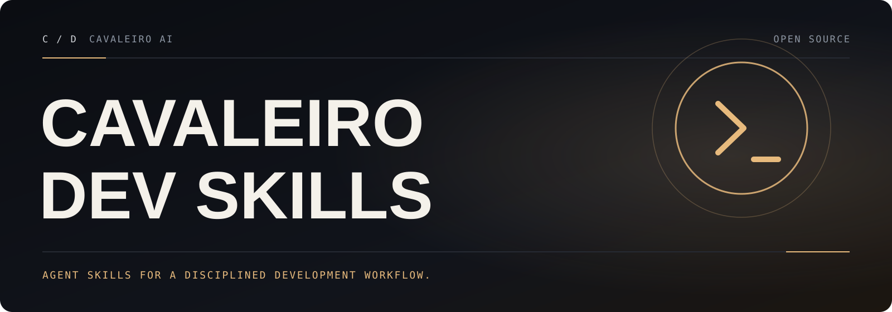

**English** · [Português (Brasil)](README.pt-BR.md)

<a id="top"></a>

<p align="center">
  
</p>

# Cavaleiro Dev Skills

**A complete software development methodology for your coding agents — brainstorm, plan, test first, debug systematically, review, and finish cleanly.**

Cavaleiro Dev Skills is a set of composable skills plus a small bootstrap that makes sure your agent uses them. This release keeps the methodology and every identifier intact (see [Compatibility](#compatibility)), and adds verified fixes to the hooks, helper scripts, and skills, a test runner for the plugin infrastructure, and Portuguese documentation.

## Table of contents

- [How it works](#how-it-works)
- [What Cavaleiro Dev Skills adds](#what-cavaleiro-dev-skills-adds)
- [Installation](#installation)
- [The basic workflow](#the-basic-workflow)
- [When something goes wrong](#when-something-goes-wrong)
- [What's inside](#whats-inside)
- [Philosophy](#philosophy)
- [Compatibility](#compatibility)
- [Testing and contributing](#testing-and-contributing)
- [Updating](#updating)
- [Visual companion telemetry](#visual-companion-telemetry)
- [License](#license)

Documentation in Portuguese: [README.pt-BR.md](README.pt-BR.md) and the full guide [docs/cavaleiro/GUIA-PT-BR.md](docs/cavaleiro/GUIA-PT-BR.md). Engineering notes for this release: [docs/cavaleiro/ENGINEERING.md](docs/cavaleiro/ENGINEERING.md).

## How it works

It starts from the moment you fire up your coding agent. As soon as it sees that you're building something, it *doesn't* just jump into trying to write code. Instead, it steps back and asks you what you're really trying to do.

Once it's teased a spec out of the conversation, it shows it to you in chunks short enough to actually read and digest.

After you've signed off on the design, your agent puts together an implementation plan that's clear enough for an enthusiastic junior engineer with poor taste, no judgement, no project context, and an aversion to testing to follow. It emphasizes true red/green TDD, YAGNI (You Aren't Gonna Need It), and DRY.

Next up, once you say "go", it launches a *subagent-driven-development* process, having agents work through each engineering task, inspecting and reviewing their work, and continuing forward. It's not uncommon for your agent to work autonomously for a couple hours at a time without deviating from the plan you put together.

There's a bunch more to it, but that's the core of the system. And because the skills trigger automatically, you don't need to do anything special.

## What Cavaleiro Dev Skills adds

Changes on top of the 7.0.0 baseline this project is built on (details and evidence in the [changelog](CHANGELOG.md#cavaleiro-dev-skills-100--2026-10-17) and [engineering notes](docs/cavaleiro/ENGINEERING.md)):

- **Muse bootstrap on Debian/Ubuntu:** the Muse SessionStart hook runs the bash-only `hooks/session-start` with `bash`, not `sh` (dash), so the bootstrap is injected instead of failing with "Bad substitution".
- **Subagent-driven development fixes:** `task-brief` matches whole task ids (Task 6 no longer swallows Task 6b); the helpers work on a greenfield project before `git init` and fail with an actionable message instead of git's bare fatal; skills run helpers by path from the project worktree, never from the plugin's directory.
- **Safer worktree handling:** the `using-git-worktrees` ignore check tests the directory actually selected and works before it exists; `finishing-a-development-branch` checks for a surviving plan workspace before removing a worktree, because git deletes ignored files without asking.
- **Script fixes:** the visual companion accepts a relative `--project-dir`; `render-graphs.js` finds diagrams in CRLF files and exits non-zero when rendering fails; `lint-shell.sh --help` prints its whole usage; `bump-version.sh` works with Windows builds of jq/yq and rejects malformed versions instead of splicing them into a jq program; `executing-plans` helpers survive stripped exec bits.
- **Tests you can run anywhere:** `bash tests/run-plugin-tests.sh` runs every non-LLM suite and skips the ones whose optional tools are missing; a new static validator checks every skill and manifest; a snippet test runs the shell commands skills print, exactly as printed; a GitHub Actions workflow runs it all with a read-only token.
- **Fork safety:** the Codex marketplace sync script pushes only to a fork you configure, issue reports from `diagnosing-superpowers` go to this repository, and the community files point here.
- **Ready for collaboration:** issue forms, a pull request template, [contributing guide](CONTRIBUTING.md), [security policy](SECURITY.md), [code of conduct](CODE_OF_CONDUCT.md), Dependabot, and a [changelog](CHANGELOG.md).

## Installation

Installation differs by harness. If you use more than one, install separately for each one.

**Install either the original project or Cavaleiro Dev Skills in a harness, not both.** Both register the plugin id `superpowers` and the same skill names (see [Compatibility](#compatibility)). The `superpowers` entries in official marketplaces (Anthropic, OpenAI Codex, Cursor, xAI, Kimi) install the original project; the commands below install Cavaleiro Dev Skills from this repository.

### Claude Code

```bash
/plugin marketplace add cavaleiro-ai/cavaleiro-dev-skills
/plugin install superpowers@superpowers-dev
```

The repository is its own marketplace (`.claude-plugin/marketplace.json`, marketplace name `superpowers-dev`).

### Antigravity

```bash
agy plugin install https://github.com/cavaleiro-ai/cavaleiro-dev-skills
```

Antigravity lists each installed skill's description, and the description of the `using-superpowers` skill prompts the model to load that skill at the start of a conversation. Reinstall with the same command to update.

### Codex App and Codex CLI

The `superpowers` plugin in the [official Codex plugin marketplace](https://github.com/openai/plugins) is the original project. To run Cavaleiro Dev Skills, clone this repository and add it as a local marketplace: it ships the development marketplace file `.agents/plugins/marketplace.json` and the plugin manifest `.codex-plugin/plugin.json`. Follow your Codex version's documentation for local marketplaces.

### Cursor

Cursor's marketplace entry (`/add-plugin superpowers`) installs the original project. This repository ships the Cursor manifest `.cursor-plugin/plugin.json` and `hooks/hooks-cursor.json` for a local plugin install from a clone.

### Devin CLI

```bash
devin plugins install cavaleiro-ai/cavaleiro-dev-skills
devin plugins update superpowers
```

### Factory Droid

```bash
droid plugin marketplace add https://github.com/cavaleiro-ai/cavaleiro-dev-skills
```

Then install the `superpowers` plugin from that marketplace (`droid plugin marketplace list` shows the marketplace's name).

### Gemini CLI

```bash
gemini extensions install https://github.com/cavaleiro-ai/cavaleiro-dev-skills
gemini extensions update superpowers
```

### GitHub Copilot CLI

```bash
copilot plugin marketplace add cavaleiro-ai/cavaleiro-dev-skills
copilot plugin install superpowers@superpowers-dev
```

### Grok Build CLI

The `superpowers@xai-official` plugin in [xAI's marketplace](https://github.com/xai-org/plugin-marketplace) is the original project; Cavaleiro Dev Skills is not listed there.

### Kimi Code

```text
/plugins install https://github.com/cavaleiro-ai/cavaleiro-dev-skills
```

Detailed docs: [docs/README.kimi.md](docs/README.kimi.md).

### OpenCode

OpenCode uses its own plugin install; install separately even if you already use another harness. Tell OpenCode:

```text
Fetch and follow instructions from https://raw.githubusercontent.com/cavaleiro-ai/cavaleiro-dev-skills/refs/heads/main/.opencode/INSTALL.md
```

Detailed docs: [docs/README.opencode.md](docs/README.opencode.md).

### Pi

```bash
pi install git:github.com/cavaleiro-ai/cavaleiro-dev-skills
```

For local development, run Pi with a checkout loaded as a temporary package: `pi -e /path/to/cavaleiro-dev-skills`. The Pi package loads the skills and a small extension that injects the `using-superpowers` bootstrap at session startup and again after compaction.

### Qwen Code

Qwen Code installs plugins from Claude Code marketplaces directly. Pick `superpowers` when prompted:

```bash
qwen extensions install cavaleiro-ai/cavaleiro-dev-skills
qwen extensions update superpowers
```

### Hermes Agent

```bash
hermes plugins install cavaleiro-ai/cavaleiro-dev-skills --enable
```

Restart any active Hermes sessions after installing. Hermes has no post-compaction hook, so a very long session that compacts over its first turn loses the bootstrap — start a fresh session if skills stop triggering.

### Muse

```bash
git clone https://github.com/cavaleiro-ai/cavaleiro-dev-skills.git
muse plugins install ./cavaleiro-dev-skills
muse plugins approve superpowers
```

Update later with `muse plugins update superpowers`. Restart active Muse sessions so the `SessionStart` hook takes effect (hooks need approval on first install). The hook runs with `bash`, so it works where `/bin/sh` is dash.

### Verify any install

Start a fresh session and send `Let's make a react todo list`. A working install triggers the `brainstorming` skill before any code is written.

## The basic workflow

1. **brainstorming** — Activates before building anything. Draws out what you actually want, and why, through questions that get you describing it, then plays its understanding back for correction. Small changes get agreed in chat; projects get a written design document a builder could plan from.
2. **using-git-worktrees** — Activates after design approval. Creates an isolated workspace on a new branch, runs project setup, verifies a clean test baseline.
3. **writing-plans** — Activates with an approved design. Breaks work into bite-sized tasks (2-5 minutes each). Every task has exact file paths, complete code, verification steps.
4. **subagent-driven-development** or **executing-plans** — Activates with a plan. Either dispatches a fresh subagent per task with a review after each (most thorough), or implements every task inline in the current session with one fresh review of the whole branch at the end (cheapest).
5. **test-driven-development** — Activates during implementation. Enforces RED-GREEN-REFACTOR: write a failing test, watch it fail, write minimal code, watch it pass, commit.
6. **requesting-code-review** — Activates between tasks. Reviews against the plan, reports issues by severity. Critical issues block progress.
7. **finishing-a-development-branch** — Activates when tasks complete. Verifies tests, presents options (merge/PR/keep/discard), cleans up the worktree.

**The agent checks for relevant skills before any task.** Mandatory workflows, not suggestions.

## When something goes wrong

Sometimes a session misbehaves: a skill fires when it shouldn't, stays silent when it should, or the agent ignores its plan, repeats work, or burns more tokens than you'd expect. Ask your coding agent to "figure out what went wrong with superpowers in this session" and it will invoke the **diagnosing-superpowers** skill. To examine an earlier session, name it: "figure out what went wrong with superpowers in session `<id>`".

The skill reads the session transcript, reports what happened with line-level evidence, and, if you want, packages a scrubbed bundle for a bug report on [this repository's issues](https://github.com/cavaleiro-ai/cavaleiro-dev-skills/issues).

## What's inside

### Skills library

**Testing**
- **test-driven-development** — RED-GREEN-REFACTOR cycle (includes a testing anti-patterns reference)

**Debugging**
- **systematic-debugging** — 4-phase root cause process (includes root-cause-tracing, defense-in-depth, condition-based-waiting techniques)
- **verification-before-completion** — Ensure it's actually fixed
- **diagnosing-superpowers** — Work out what went wrong in a session, with evidence; export a scrubbed bundle or file an issue

**Collaboration**
- **brainstorming** — Drawing out intent before building (with an optional browser-based visual companion)
- **writing-plans** — Detailed implementation plans
- **executing-plans** — Inline plan execution: one context, one final review
- **dispatching-parallel-agents** — Concurrent subagent workflows
- **requesting-code-review** — Pre-review checklist
- **receiving-code-review** — Responding to feedback
- **using-git-worktrees** — Parallel development branches
- **finishing-a-development-branch** — Merge/PR decision workflow
- **subagent-driven-development** — Fast iteration with per-task review (spec compliance and code quality)

**Meta**
- **writing-skills** — Create new skills following best practices (includes testing methodology)
- **using-superpowers** — Introduction to the skills system (injected at session start)

### Repository layout

| Path | What it is |
|------|------------|
| `skills/` | The skills: one directory per skill, `SKILL.md` plus prompts, references, and helper scripts |
| `hooks/` | SessionStart hook (`session-start`) and its cross-platform wrapper (`run-hook.cmd`) |
| `.claude-plugin/`, `.codex-plugin/`, `.cursor-plugin/`, `.devin-plugin/`, `.kimi-plugin/`, `.muse-plugin/`, `.antigravity-plugin/`, `.agents/`, `gemini-extension.json` | Per-harness plugin and marketplace manifests |
| `.opencode/`, `.pi/`, `.hermes-plugin/`, `index.js`, `package.json` | In-process plugins for OpenCode, Pi, and Hermes |
| `scripts/` | Maintainer tools: version bump, shell lint, Codex packaging and sync |
| `tests/` | Plugin-infrastructure tests (no LLM needed) and LLM-driven skill tests |
| `docs/` | Harness guides, porting guide, testing guide, inherited design history, and the Cavaleiro docs |

## Philosophy

- **Test-Driven Development** — Write tests first, always
- **Systematic over ad-hoc** — Process over guessing
- **Complexity reduction** — Simplicity as primary goal
- **Evidence over claims** — Verify before declaring success

## Compatibility

Cavaleiro Dev Skills renames the **project**, not the identifiers that harnesses, users, and other tools rely on. It is a drop-in replacement for the original project's 7.0.0 release:

- **The plugin id is still `superpowers`** in every manifest: `superpowers@superpowers-dev` in Claude Code and Copilot CLI, the npm/OpenCode package `superpowers`, `muse plugins approve superpowers`, `gemini extensions update superpowers`. The marketplace names `superpowers-dev` are unchanged too.
- **Skill names are unchanged** (`brainstorming`, `using-superpowers`, `diagnosing-superpowers`, …), and so are `superpowers:<skill>` references inside skills and in your own instructions.
- **Files and paths are unchanged:** `hooks/session-start`, `hooks/run-hook.cmd`, the helper scripts and their arguments, the plan workspace `.superpowers/sdd/`, and the visual companion's `.superpowers/brainstorm/`.
- **Environment variables are unchanged:** `SUPERPOWERS_DISABLE_TELEMETRY`, the `BRAINSTORM_*` variables, and the harness variables the hook reads (`CLAUDE_PLUGIN_ROOT`, `CURSOR_PLUGIN_ROOT`, `COPILOT_CLI`, `MUSE_PLUGIN_ROOT`).
- **Manifest versions stay at `7.0.0`**, the original release this project is built on, so harness update checks and `scripts/bump-version.sh` keep working. "Cavaleiro Dev Skills 1.0.0" is the name of this project's release.
- **In-product branding is unchanged:** the app icons and the visual companion's header still show the original project's artwork, and the session bootstrap still says "You have superpowers."
- **Behavior changes** are bug fixes, each listed in the [changelog](CHANGELOG.md): `task-brief` matches whole task ids (Task 1 no longer includes a "Task 1.2" section that follows it), `sdd-workspace` falls back to the current directory outside a git repository, `review-package` exits 2 outside one, `render-graphs.js` exits 1 when a diagram fails, `bump-version.sh` accepts only `X.Y.Z[-pre][+build]`, and `scripts/sync-to-codex-plugin.sh` needs `CODEX_PLUGIN_FORK` before it clones, pushes, or opens a pull request.

## Testing and contributing

```bash
bash tests/run-plugin-tests.sh          # every non-LLM suite; missing optional tools => SKIP
node tests/skills/validate-skills.mjs   # static checks for skills and manifests
```

See [CONTRIBUTING.md](CONTRIBUTING.md) for the ground rules (skills are code, identifiers are a contract, zero dependencies, every harness) and [docs/testing.md](docs/testing.md) for every suite and the LLM-driven skill evals.

## Updating

Updates are harness-dependent and often automatic. Each harness section above lists its update command where one exists.

## Visual companion telemetry

This behavior comes unchanged from the original project, and the request goes to the **original authors'** website, not to Cavaleiro AI. By default, the logo in brainstorming's optional visual companion is loaded from `https://primeradiant.com/brand/…` with the plugin version in the URL (`?v=7.0.0`). It does not include details about your project, prompt, or coding agent; it lets the original authors estimate how many people use which version. It's optional: set `SUPERPOWERS_DISABLE_TELEMETRY` to any true value to disable it. The visual companion also honors Claude Code's `DISABLE_TELEMETRY` and `CLAUDE_CODE_DISABLE_NONESSENTIAL_TRAFFIC` opt-outs. The visual companion itself only runs when you approve it during brainstorming.

## License

Based on Superpowers · MIT License · see [LICENSE](LICENSE). Not affiliated with the original project.

<p align="center"><a href="#top">Back to top ↑</a></p>
