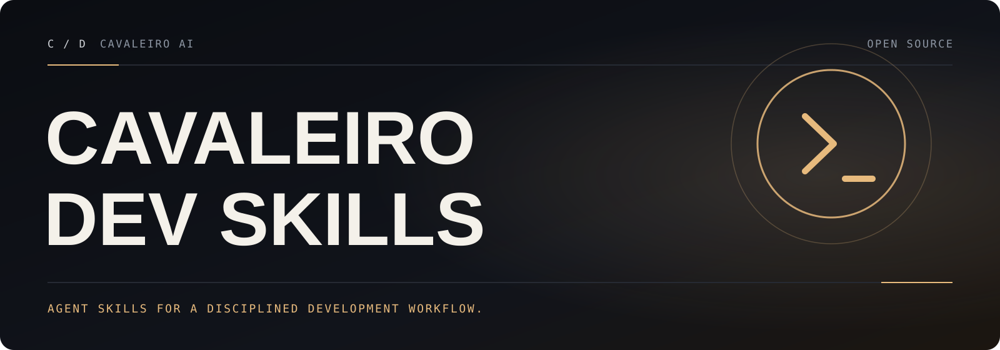

[English](README.md) · **Português (Brasil)**

<a id="top"></a>

<p align="center">
  
</p>

# Cavaleiro Dev Skills

**Uma metodologia completa de desenvolvimento de software para seus agentes de código — explorar a ideia, planejar, testar primeiro, depurar com método, revisar e finalizar com limpeza.**

O Cavaleiro Dev Skills é um conjunto de *skills* (habilidades) combináveis e um pequeno *bootstrap* que garante que o seu agente as use. Esta versão mantém a metodologia e todos os identificadores (veja [Compatibilidade](#compatibilidade)), e acrescenta correções verificadas nos hooks, scripts auxiliares e skills, um executor de testes para a infraestrutura do plugin e documentação em português.

## Sumário

- [Como funciona](#como-funciona)
- [O que o Cavaleiro Dev Skills acrescenta](#o-que-o-cavaleiro-dev-skills-acrescenta)
- [Instalação](#instalação)
- [O fluxo básico](#o-fluxo-básico)
- [Quando algo dá errado](#quando-algo-dá-errado)
- [O que vem dentro](#o-que-vem-dentro)
- [Filosofia](#filosofia)
- [Compatibilidade](#compatibilidade)
- [Testes e contribuição](#testes-e-contribuição)
- [Atualização](#atualização)
- [Telemetria do companheiro visual](#telemetria-do-companheiro-visual)
- [Licença](#licença)

Guia completo em português: [docs/cavaleiro/GUIA-PT-BR.md](docs/cavaleiro/GUIA-PT-BR.md). Notas de engenharia desta versão (em inglês): [docs/cavaleiro/ENGINEERING.md](docs/cavaleiro/ENGINEERING.md).

## Como funciona

Tudo começa no momento em que você abre o seu agente de código. Assim que ele percebe que você quer construir algo, ele *não* sai escrevendo código. Primeiro ele dá um passo atrás e pergunta o que você realmente quer fazer.

Depois de extrair uma especificação da conversa, ele a mostra em partes curtas o bastante para serem lidas e digeridas de verdade.

Quando você aprova o desenho, o agente monta um plano de implementação claro o suficiente para ser seguido por um engenheiro júnior entusiasmado, sem bom gosto, sem critério, sem contexto do projeto e com aversão a testes. O plano enfatiza TDD de verdade (vermelho/verde), YAGNI (*You Aren't Gonna Need It*) e DRY.

Em seguida, quando você diz "vai", ele inicia um processo de *subagent-driven-development*: subagentes executam cada tarefa de engenharia, o trabalho deles é inspecionado e revisado, e o processo segue em frente. Não é raro o agente trabalhar de forma autônoma por algumas horas sem se desviar do plano que vocês montaram.

Há bem mais coisa, mas esse é o núcleo do sistema. E como as skills são acionadas automaticamente, você não precisa fazer nada de especial.

## O que o Cavaleiro Dev Skills acrescenta

Mudanças sobre a base 7.0.0 em que este projeto foi construído (detalhes e evidências no [changelog](CHANGELOG.md#cavaleiro-dev-skills-100--2026-10-17) e nas [notas de engenharia](docs/cavaleiro/ENGINEERING.md)):

- **Bootstrap do Muse em Debian/Ubuntu:** o hook SessionStart do Muse executa `hooks/session-start` (exclusivo de bash) com `bash`, e não com `sh` (dash); assim o bootstrap é injetado em vez de falhar com "Bad substitution".
- **Correções do desenvolvimento orientado a subagentes:** `task-brief` compara o identificador inteiro da tarefa (a Task 6 não engole mais a Task 6b); os scripts auxiliares funcionam num projeto novo antes do `git init` e falham com uma mensagem útil em vez do erro cru do git; as skills mandam executar os auxiliares pelo caminho, a partir da worktree do projeto, nunca do diretório do plugin.
- **Worktrees mais seguras:** a verificação de `.gitignore` do `using-git-worktrees` testa o diretório realmente escolhido e funciona antes de ele existir; o `finishing-a-development-branch` procura um workspace de plano remanescente antes de remover uma worktree, porque o git apaga arquivos ignorados sem perguntar.
- **Correções de scripts:** o companheiro visual aceita `--project-dir` relativo; `render-graphs.js` encontra diagramas em arquivos CRLF e sai com código diferente de zero quando a renderização falha; `lint-shell.sh --help` mostra o texto de uso inteiro; `bump-version.sh` funciona com as versões Windows de jq/yq e rejeita versões malformadas em vez de inseri-las num programa jq; os auxiliares do `executing-plans` sobrevivem à perda do bit de execução.
- **Testes que rodam em qualquer lugar:** `bash tests/run-plugin-tests.sh` executa todas as suítes sem LLM e pula (SKIP) as que dependem de ferramentas opcionais ausentes; um novo validador estático confere todas as skills e manifestos; um teste de trechos executa os comandos de shell que as skills imprimem, exatamente como impressos; um workflow do GitHub Actions roda tudo com token somente leitura.
- **Segurança do fork:** o script de sincronização com o marketplace do Codex só envia para um fork que você configurar; os relatos do `diagnosing-superpowers` vão para este repositório; os arquivos de comunidade apontam para cá.
- **Pronto para colaboração:** formulários de issue, modelo de pull request, [guia de contribuição](CONTRIBUTING.md), [política de segurança](SECURITY.md), [código de conduta](CODE_OF_CONDUCT.md), Dependabot e [changelog](CHANGELOG.md).

## Instalação

A instalação muda conforme a ferramenta (o *harness*). Se você usa mais de uma, instale em cada uma separadamente.

**Instale o projeto original ou o Cavaleiro Dev Skills numa ferramenta, não os dois.** Ambos registram o id de plugin `superpowers` e os mesmos nomes de skill (veja [Compatibilidade](#compatibilidade)). As entradas `superpowers` dos marketplaces oficiais (Anthropic, OpenAI Codex, Cursor, xAI, Kimi) instalam o projeto original; os comandos abaixo instalam o Cavaleiro Dev Skills a partir deste repositório.

### Claude Code

```bash
/plugin marketplace add cavaleiro-ai/cavaleiro-dev-skills
/plugin install superpowers@superpowers-dev
```

O repositório é o seu próprio marketplace (`.claude-plugin/marketplace.json`, nome do marketplace `superpowers-dev`).

### Antigravity

```bash
agy plugin install https://github.com/cavaleiro-ai/cavaleiro-dev-skills
```

O Antigravity lista a descrição de cada skill instalada, e a descrição da skill `using-superpowers` faz o modelo carregá-la no início da conversa. Reinstale com o mesmo comando para atualizar.

### Codex App e Codex CLI

O plugin `superpowers` do [marketplace oficial do Codex](https://github.com/openai/plugins) é o projeto original. Para usar o Cavaleiro Dev Skills, clone este repositório e adicione-o como marketplace local: ele traz o arquivo de marketplace de desenvolvimento `.agents/plugins/marketplace.json` e o manifesto `.codex-plugin/plugin.json`. Siga a documentação da sua versão do Codex para marketplaces locais.

### Cursor

A entrada do marketplace do Cursor (`/add-plugin superpowers`) instala o projeto original. Este repositório traz o manifesto `.cursor-plugin/plugin.json` e `hooks/hooks-cursor.json` para instalação local a partir de um clone.

### Devin CLI

```bash
devin plugins install cavaleiro-ai/cavaleiro-dev-skills
devin plugins update superpowers
```

### Factory Droid

```bash
droid plugin marketplace add https://github.com/cavaleiro-ai/cavaleiro-dev-skills
```

Depois instale o plugin `superpowers` desse marketplace (`droid plugin marketplace list` mostra o nome do marketplace).

### Gemini CLI

```bash
gemini extensions install https://github.com/cavaleiro-ai/cavaleiro-dev-skills
gemini extensions update superpowers
```

### GitHub Copilot CLI

```bash
copilot plugin marketplace add cavaleiro-ai/cavaleiro-dev-skills
copilot plugin install superpowers@superpowers-dev
```

### Grok Build CLI

O plugin `superpowers@xai-official` do [marketplace da xAI](https://github.com/xai-org/plugin-marketplace) é o projeto original; o Cavaleiro Dev Skills não está listado lá.

### Kimi Code

```text
/plugins install https://github.com/cavaleiro-ai/cavaleiro-dev-skills
```

Documentação detalhada (em inglês): [docs/README.kimi.md](docs/README.kimi.md).

### OpenCode

O OpenCode tem instalação própria de plugins; instale separadamente mesmo que já use outra ferramenta. Diga ao OpenCode:

```text
Fetch and follow instructions from https://raw.githubusercontent.com/cavaleiro-ai/cavaleiro-dev-skills/refs/heads/main/.opencode/INSTALL.md
```

Documentação detalhada (em inglês): [docs/README.opencode.md](docs/README.opencode.md).

### Pi

```bash
pi install git:github.com/cavaleiro-ai/cavaleiro-dev-skills
```

Para desenvolvimento local, rode o Pi com um clone carregado como pacote temporário: `pi -e /caminho/para/cavaleiro-dev-skills`. O pacote do Pi carrega as skills e uma pequena extensão que injeta o bootstrap `using-superpowers` ao iniciar a sessão e de novo após a compactação.

### Qwen Code

O Qwen Code instala plugins diretamente de marketplaces do Claude Code. Escolha `superpowers` quando perguntado:

```bash
qwen extensions install cavaleiro-ai/cavaleiro-dev-skills
qwen extensions update superpowers
```

### Hermes Agent

```bash
hermes plugins install cavaleiro-ai/cavaleiro-dev-skills --enable
```

Reinicie as sessões ativas do Hermes depois de instalar. O Hermes não tem hook pós-compactação, então uma sessão muito longa que compacta o primeiro turno perde o bootstrap — abra uma sessão nova se as skills pararem de disparar.

### Muse

```bash
git clone https://github.com/cavaleiro-ai/cavaleiro-dev-skills.git
muse plugins install ./cavaleiro-dev-skills
muse plugins approve superpowers
```

Atualize depois com `muse plugins update superpowers`. Reinicie as sessões ativas do Muse para o hook `SessionStart` valer (hooks precisam de aprovação na primeira instalação). O hook roda com `bash`, então funciona onde `/bin/sh` é o dash.

### Verifique qualquer instalação

Abra uma sessão nova e envie `Let's make a react todo list`. Uma instalação funcionando aciona a skill `brainstorming` antes de qualquer código ser escrito.

## O fluxo básico

1. **brainstorming** — Ativa antes de construir qualquer coisa. Extrai o que você realmente quer, e por quê, com perguntas que fazem você descrever a ideia, e depois devolve o entendimento para correção. Mudanças pequenas são combinadas no chat; projetos ganham um documento de desenho que um executor conseguiria planejar.
2. **using-git-worktrees** — Ativa após a aprovação do desenho. Cria um workspace isolado num branch novo, roda a preparação do projeto e verifica uma linha de base de testes limpa.
3. **writing-plans** — Ativa com o desenho aprovado. Quebra o trabalho em tarefas pequenas (2 a 5 minutos cada), cada uma com caminhos exatos de arquivo, código completo e passos de verificação.
4. **subagent-driven-development** ou **executing-plans** — Ativa com um plano. Ou despacha um subagente novo por tarefa, com revisão após cada uma (mais rigoroso), ou implementa todas as tarefas na sessão atual com uma única revisão nova do branch inteiro no fim (mais barato).
5. **test-driven-development** — Ativa durante a implementação. Impõe VERMELHO-VERDE-REFATORA: escreva um teste que falha, veja falhar, escreva o mínimo de código, veja passar, faça commit.
6. **requesting-code-review** — Ativa entre tarefas. Revisa contra o plano e relata problemas por severidade. Problemas críticos bloqueiam o avanço.
7. **finishing-a-development-branch** — Ativa quando as tarefas terminam. Verifica os testes, apresenta opções (merge/PR/manter/descartar) e limpa a worktree.

**O agente procura skills relevantes antes de qualquer tarefa.** São fluxos obrigatórios, não sugestões.

## Quando algo dá errado

Às vezes uma sessão se comporta mal: uma skill dispara quando não devia, fica quieta quando devia agir, ou o agente ignora o plano, repete trabalho ou gasta mais tokens do que o esperado. Peça ao seu agente "figure out what went wrong with superpowers in this session" e ele vai usar a skill **diagnosing-superpowers**. Para examinar uma sessão anterior, informe qual: "figure out what went wrong with superpowers in session `<id>`".

A skill lê a transcrição da sessão, relata o que aconteceu com evidência linha a linha e, se você quiser, empacota um pacote sanitizado para um relato de bug nas [issues deste repositório](https://github.com/cavaleiro-ai/cavaleiro-dev-skills/issues).

## O que vem dentro

### Biblioteca de skills

**Testes**
- **test-driven-development** — Ciclo VERMELHO-VERDE-REFATORA (inclui referência de antipadrões de teste)

**Depuração**
- **systematic-debugging** — Processo de causa raiz em 4 fases (inclui técnicas de rastreamento de causa raiz, defesa em profundidade e espera baseada em condição)
- **verification-before-completion** — Garante que está realmente resolvido
- **diagnosing-superpowers** — Descobre o que deu errado numa sessão, com evidências; exporta um pacote sanitizado ou abre uma issue

**Colaboração**
- **brainstorming** — Extrair a intenção antes de construir (com um companheiro visual opcional no navegador)
- **writing-plans** — Planos de implementação detalhados
- **executing-plans** — Execução do plano na própria sessão: um contexto, uma revisão final
- **dispatching-parallel-agents** — Fluxos com subagentes concorrentes
- **requesting-code-review** — Checklist pré-revisão
- **receiving-code-review** — Como responder a feedback
- **using-git-worktrees** — Branches de desenvolvimento em paralelo
- **finishing-a-development-branch** — Decisão entre merge e PR
- **subagent-driven-development** — Iteração rápida com revisão por tarefa (conformidade com a especificação e qualidade de código)

**Meta**
- **writing-skills** — Criar skills novas seguindo boas práticas (inclui metodologia de teste)
- **using-superpowers** — Introdução ao sistema de skills (injetada no início da sessão)

### Estrutura do repositório

| Caminho | O que é |
|---------|---------|
| `skills/` | As skills: um diretório por skill, `SKILL.md` mais prompts, referências e scripts auxiliares |
| `hooks/` | Hook SessionStart (`session-start`) e o wrapper multiplataforma (`run-hook.cmd`) |
| `.claude-plugin/`, `.codex-plugin/`, `.cursor-plugin/`, `.devin-plugin/`, `.kimi-plugin/`, `.muse-plugin/`, `.antigravity-plugin/`, `.agents/`, `gemini-extension.json` | Manifestos de plugin e de marketplace de cada ferramenta |
| `.opencode/`, `.pi/`, `.hermes-plugin/`, `index.js`, `package.json` | Plugins em processo para OpenCode, Pi e Hermes |
| `scripts/` | Ferramentas de manutenção: troca de versão, lint de shell, empacotamento e sincronização do Codex |
| `tests/` | Testes da infraestrutura do plugin (sem LLM) e testes de skills com LLM |
| `docs/` | Guias por ferramenta, guia de portabilidade, guia de testes, histórico de desenho herdado e a documentação Cavaleiro |

## Filosofia

- **Desenvolvimento guiado por testes** — Teste primeiro, sempre
- **Sistemático em vez de improvisado** — Processo em vez de chute
- **Redução de complexidade** — Simplicidade como objetivo principal
- **Evidência em vez de alegação** — Verifique antes de declarar sucesso

## Compatibilidade

O Cavaleiro Dev Skills renomeia o **projeto**, não os identificadores de que ferramentas, usuários e outras integrações dependem. Ele substitui a versão 7.0.0 do projeto original sem ajustes:

- **O id do plugin continua `superpowers`** em todos os manifestos: `superpowers@superpowers-dev` no Claude Code e no Copilot CLI, o pacote npm/OpenCode `superpowers`, `muse plugins approve superpowers`, `gemini extensions update superpowers`. Os nomes de marketplace `superpowers-dev` também não mudaram.
- **Os nomes das skills não mudaram** (`brainstorming`, `using-superpowers`, `diagnosing-superpowers`, …), nem as referências `superpowers:<skill>` dentro das skills e nas suas próprias instruções.
- **Arquivos e caminhos não mudaram:** `hooks/session-start`, `hooks/run-hook.cmd`, os scripts auxiliares e seus argumentos, o workspace de plano `.superpowers/sdd/` e o `.superpowers/brainstorm/` do companheiro visual.
- **Variáveis de ambiente não mudaram:** `SUPERPOWERS_DISABLE_TELEMETRY`, as variáveis `BRAINSTORM_*` e as variáveis das ferramentas que o hook lê (`CLAUDE_PLUGIN_ROOT`, `CURSOR_PLUGIN_ROOT`, `COPILOT_CLI`, `MUSE_PLUGIN_ROOT`).
- **As versões nos manifestos continuam `7.0.0`**, a versão original sobre a qual este projeto foi construído, para que as verificações de atualização das ferramentas e o `scripts/bump-version.sh` continuem funcionando. "Cavaleiro Dev Skills 1.0.0" é o nome desta versão do projeto.
- **A marca dentro do produto não mudou:** os ícones e o cabeçalho do companheiro visual ainda mostram a arte do projeto original, e o bootstrap da sessão ainda diz "You have superpowers."
- **Mudanças de comportamento** são correções de bugs, todas listadas no [changelog](CHANGELOG.md): `task-brief` compara o id inteiro da tarefa (a Task 1 não inclui mais uma seção "Task 1.2" logo depois dela), `sdd-workspace` usa o diretório atual fora de um repositório git, `review-package` sai com código 2 fora de um, `render-graphs.js` sai com 1 quando um diagrama falha, `bump-version.sh` aceita apenas `X.Y.Z[-pre][+build]` e `scripts/sync-to-codex-plugin.sh` exige `CODEX_PLUGIN_FORK` antes de clonar, enviar ou abrir um pull request.

## Testes e contribuição

```bash
bash tests/run-plugin-tests.sh          # todas as suítes sem LLM; ferramenta opcional ausente => SKIP
node tests/skills/validate-skills.mjs   # verificações estáticas de skills e manifestos
```

Veja o [CONTRIBUTING.md](CONTRIBUTING.md) (em inglês) para as regras básicas — skills são código, identificadores são contrato, zero dependências, todas as ferramentas — e o [docs/testing.md](docs/testing.md) para cada suíte e para as avaliações de skills com LLM. O [guia em português](docs/cavaleiro/GUIA-PT-BR.md#como-contribuir) resume tudo isso.

## Atualização

As atualizações dependem da ferramenta e muitas vezes são automáticas. Cada seção de instalação acima mostra o comando de atualização quando ele existe.

## Telemetria do companheiro visual

Este comportamento vem sem alterações do projeto original, e a requisição vai para o site dos **autores originais**, não para a Cavaleiro AI. Por padrão, o logotipo no companheiro visual opcional do brainstorming é carregado de `https://primeradiant.com/brand/…` com a versão do plugin na URL (`?v=7.0.0`). Não inclui detalhes do seu projeto, prompt ou agente; serve para os autores originais estimarem quantas pessoas usam cada versão. É opcional: defina `SUPERPOWERS_DISABLE_TELEMETRY` com qualquer valor verdadeiro para desligar. O companheiro visual também respeita as opções `DISABLE_TELEMETRY` e `CLAUDE_CODE_DISABLE_NONESSENTIAL_TRAFFIC` do Claude Code. O próprio companheiro visual só roda quando você aprova o uso dele durante o brainstorming.

## Licença

Baseado no Superpowers · licença MIT · veja [LICENSE](LICENSE). Sem afiliação com o projeto original.

<p align="center"><a href="#top">Voltar ao topo ↑</a></p>
